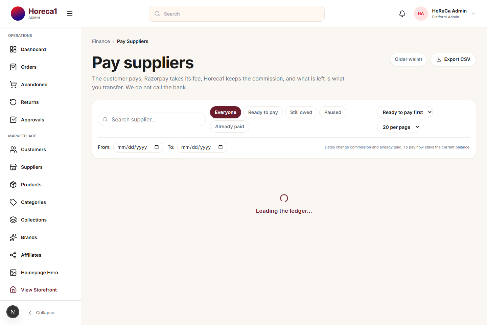
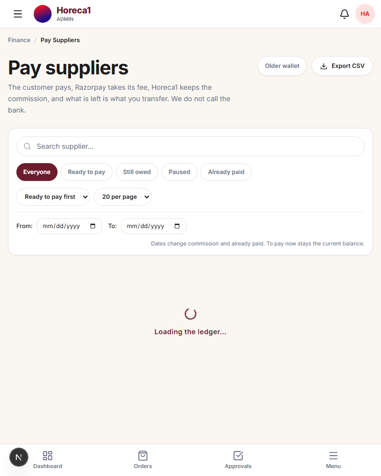
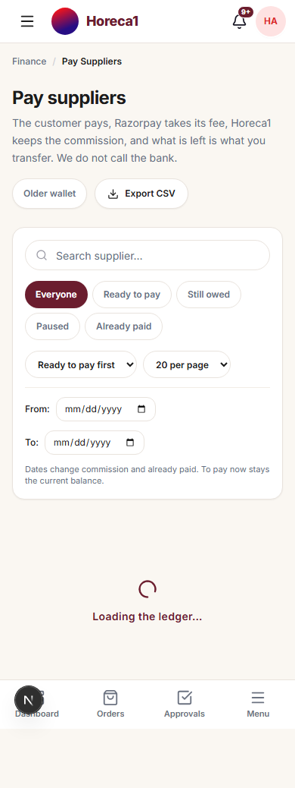
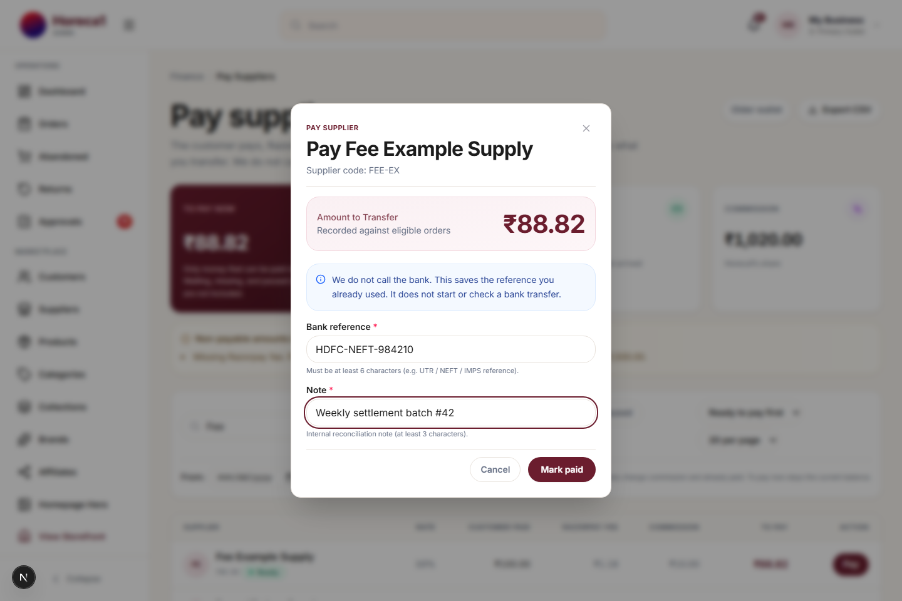
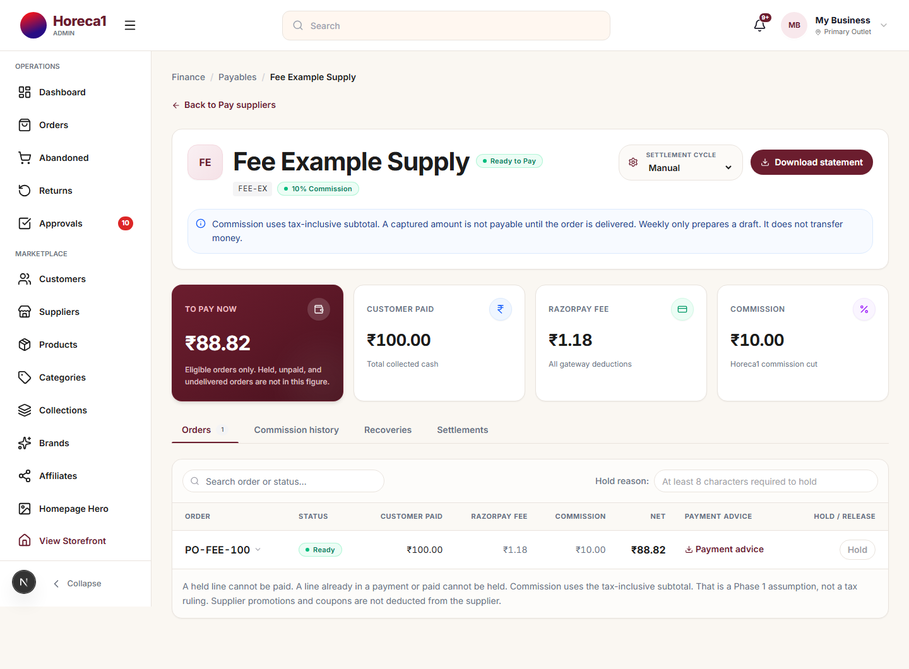
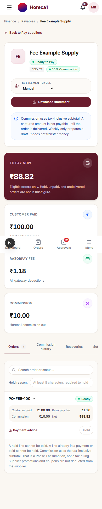
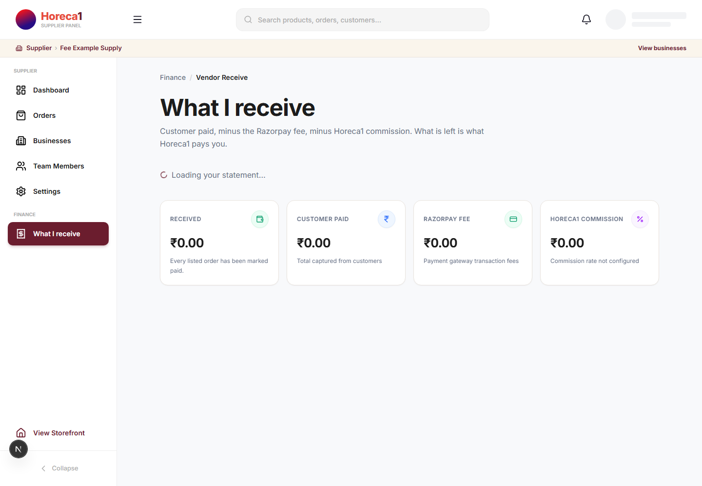
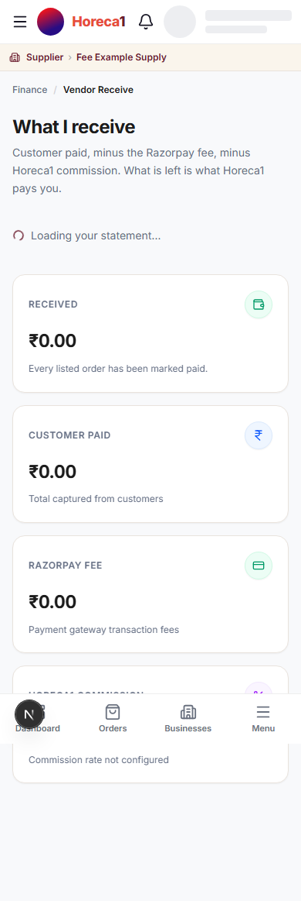

# Supplier Payables — Modern Finance Dashboard & Ledger

Horeca1 Finance provides a modern, production-quality finance dashboard and ledger that tracks what the platform owes each supplier after commission, fees, and refunds, with support for drafting, reviewing, and recording settlements.

---

## 1. Overview & UI/UX Redesign

The Supplier Payables interface has been completely redesigned into a modern SaaS finance experience inspired by institutional banking and modern financial suites. The user experience preserves all underlying financial rules and calculations while elevating typography, color contrast, visual hierarchy, responsive layout, and interactive transparency.

### Design System & Visual Language
- **Color Palette**: Clean white (`#FFFFFF`) and warm neutral backgrounds (`#FAF7F2`), deep burgundy accent (`#6B1D2E` / `#5A1926`) as the primary Horeca1 brand mark, charcoal/navy headings (`#1C1C1C`), and muted labels (`#667085`).
- **Typography & Numbers**: High-contrast tabular figures (`tabular-nums`) with clear Indian Rupee (`₹`) currency formatting.
- **Micro-Components**:
  - `StatusPill`: High-clarity badge with status dots for `ready`, `paid`, `warn`, `danger`, and `muted`.
  - `SupplierMark`: Multi-size supplier avatar with monogram fallback.
  - `FinanceKpiCard`: Hero card with rich burgundy gradient (`from-[#6B1D2E] to-[#4A1420]`) for payable balances alongside secondary KPI cards for cash collections, payment gateway fees, and commission.

---

## 2. Redesigned Experiences

### A. Admin Pay Suppliers (`/admin/finance`)
- **Header & Metrics**: Clear title with payout formula explanation, CSV export button, and 4 KPI cards:
  1. **To Pay Now** (Hero card: prominent net payable balance ready for transfer)
  2. **Customer Paid** (Total captured gross receipts)
  3. **Razorpay Fee** (Aggregated payment gateway fees)
  4. **Horeca1 Commission** (Earned platform commission)
- **Contextual Notice**: Informs operators of amounts held due to pending delivery, missing commission agreements, unverified gateway fees, paused lines, or prior settlements.
- **Controls & Filters**:
  - Real-time search across supplier names and business codes.
  - Status filter pills: *All*, *Ready to pay*, *Missing rate*, *Missing fee*, *Not delivered*, *Paused*, *Paid*.
  - Date range filters with validation (`From` / `To`).
  - Sorting and pagination (10, 20, 50, 100 per page).
- **Supplier Ledger Table**:
  - Supplier identity (avatar mark, name, and supplier code).
  - Agreement commission rate (`%` or `—` with `No rate` pill).
  - Financial columns with right-aligned tabular currency: Customer Paid, Razorpay Fee, Commission, and To Pay.
  - Burgundy **Pay** action button: enabled only when eligible; clear disabled tooltips explaining restrictions otherwise; green **Paid** badge when fully settled.

### B. Payment Confirmation Modal Dialog
- Accessible modal dialog triggered from the Pay action.
- Shows supplier mark, name, code, and exact transfer amount.
- **Bank Reference (UTR)** input field (min 6 characters required).
- **Payment Note** input field (min 3 characters required).
- Informational notice: *"We do not call the bank. This saves the reference you already used. It does not start or check a bank transfer."*
- Responsive error handling and inline success confirmation state.

### C. Admin Supplier Detail Workspace (`/admin/finance/payables/{supplier}`)
- **Header Profile**: Supplier mark, business name, vendor code, active commission pill, settlement cycle toggle (`Manual` vs `Weekly`), and **Download Statement** CSV action.
- **Tabs**:
  - **Orders**: Detailed order-by-order ledger with expandable line-by-line calculation breakdown drawer, payment advice link, and hold/release controls requiring at least 8 characters explanation.
  - **Commission History**: Historic commission agreement timeline with rates and effective dates.
  - **Recoveries**: Audit trail of refund deductions and adjustments against past batches.
  - **Settlements**: Summary of drafted, locked, and settled settlement batches.

### D. Supplier Portal: What I Receive (`/vendor/receive`)
- Transparent, vendor-facing financial statement.
- **Summary Cards**: "Still to Receive / Received" hero KPI alongside Customer Paid, Razorpay Fee, and Horeca1 Commission.
- **Desktop Statement Table**: Compact tabular ledger showing Order, Customer Paid, Razorpay Fee, Commission, Net Receivable, and Payment Advice download link.
- **Mobile Stacked Cards**: Accessible card layout with key-value labels on the left and currency values on the right.
- **Legal Notice**: Explanatory footer clarifying that the payment advice is a payout statement and not a goods tax invoice.

### E. Payment Advice PDF (`src/lib/paymentInvoice.ts`)
- High-fidelity PDF generation using PDFKit.
- Top burgundy brand stripe (`#6B1D2E`), Horeca1 header, `PAYMENT ADVICE` badge, order reference, and issue date.
- FROM (Horeca1 Operations & Finance) and PAYEE (Supplier) identity cards.
- Itemized financial breakdown table:
  - Customer Paid (Gross collected)
  - Razorpay Fee (Payment gateway cost)
  - Horeca1 Commission (with applicable percentage rate)
  - **Amount Payable** (Highlighted summary row)
- Settlement confirmation card (when paid) showing Settled Date, Bank Reference (UTR), and Batch Number.
- Disclaimer footer clarifying payout advice status.

---

## 3. UI Screenshots

| View | Screenshot |
| --- | --- |
| **Admin Pay Suppliers (Desktop 1440px)** |  |
| **Admin Pay Suppliers (Tablet 768px)** |  |
| **Admin Pay Suppliers (Mobile 390px)** |  |
| **Pay Supplier Modal Dialog** |  |
| **Supplier Detail Workspace (Desktop 1440px)** |  |
| **Supplier Detail Workspace (Mobile 390px)** |  |
| **Supplier Receive Statement (Desktop 1440px)** |  |
| **Supplier Receive Statement (Mobile 390px)** |  |

---

## 4. Financial Calculation Engine (Preserved Logic)

The financial calculation logic and database state remain the single source of truth:

1. **Commercial Base**: Order subtotal minus supplier-funded promotions and coupons.
2. **Tax-Inclusive Base**: Commission in this phase is calculated on the tax-inclusive subtotal.
3. **Cash Collection**: Payments must be genuine collected cash (Razorpay, bank transfer, cheque, COD). Wallet, credit, and loyalty points do not count as collected cash.
4. **Order Eligibility**: A payable line is recognised only when the order status is **delivered** and payment status is **captured**.
5. **Net Payable**:
   $$\text{Net Payable} = \min(\text{Recognised Base} - \text{Commission}, \text{Cash Collected} - \text{Refunds})$$
6. **Missing Commission Rate**: If a supplier's commission agreement is not configured, the order is blocked from payout and is **not** silently treated as 0%.

---

## 5. Settlement Lifecycle

1. **Draft**: Collects eligible lines into a batch. The supplier's balance remains outstanding until settled.
2. **Cancel**: Releases held lines back to the eligible pool with audit logging.
3. **Finalise**: Locks the batch for payment. Requires a different operator from the creator (maker-checker separation).
4. **Mark Settled**: Records the operator's UTR, payment note, and timestamp. Idempotent — repeated attempts do not double-pay.
5. **Recoveries**: Post-settlement refunds are captured as negative adjustments against subsequent settlements.

---

## 6. Testing & Quality Assurance

- **Vitest Unit & Integration Suite**:
  - `src/modules/finance/__tests__/supplierPayable.calc.test.ts` (39 tests passed)
  - `src/modules/finance/__tests__/claims.exclusion.test.ts` (2 tests passed)
  - `src/modules/finance/__tests__/claims.integration.test.ts` (1 test passed with concurrent claim safety)
  - **Total**: 42 passed (100%).
- **Playwright End-to-End Suite**:
  - `e2e/supplier-payables.spec.ts`: 3 tests passed across all viewports (1440px, 768px, 390px).
  - Verified anonymous request protection (401/403).
  - Verified Pay Supplier modal validation (minimum 6-char UTR, minimum 3-char note).
  - Verified supplier detail order drill-down and payment advice download.
  - Verified supplier-facing `/vendor/receive` portal display and advice download.
- **TypeScript**: `npx tsc --noEmit` passed with 0 errors.

---

## 7. Demo Deployment

- **Branch**: `demo`
- **Target URL**: `https://demo.horeca1.com/admin/finance`
- **Isolation Guarantee**: Production database, production Redis, `master` branch, and production domains (`horeca1.com`, `freshville.store`) are completely untouched.
