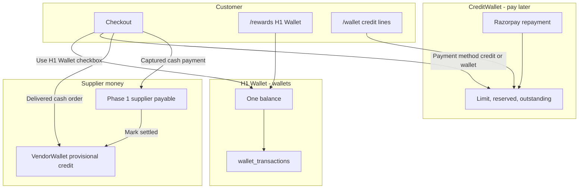

# Horeca1 wallet investigation

Read-only review of the `demo` branch. No application code, database rows, configuration, or production systems were changed. The knowledge-graph service was unavailable, so this note is based on the Prisma schema, services, API routes, and screens.

There is no separate client wallet specification in the repository. Older notes (`WHAT_WE_BUILT.md`, `ROADMAP.md` item S3) say the prepaid wallet is schema-only. That is out of date. The prepaid balance is live, and it is the promotions **H1 Wallet**, not a cash top-up wallet. Phase 1 supplier payables are documented in `docs/finance-ledger/`.

## 1. Three different “wallets”

The word wallet is used for three ledgers that do not share a balance.

| Name in the product | What the money is | Tables | Customer screen | Do not confuse with |
| --- | --- | --- | --- | --- |
| **H1 Wallet** | One spendable rupee balance: cashback, welcome/referral credits, admin grants, return credit notes | `wallets`, `wallet_transactions`, plus `cashback_entries` | `/rewards` | Checkout payment method named “Horeca1 Credit” |
| **Credit line** | Buy-now-pay-later limit. Using it creates a debt. Repaying it does not add spendable cash | `credit_wallets` and related tables | `/wallet` | H1 Wallet |
| **Supplier wallet** | Provisional record of what an old settlement job thought the supplier had earned | `vendor_wallets`, `vendor_wallet_txns` | `/vendor/wallet` | Phase 1 “What I receive” (`/vendor/receive`, `/admin/finance`) |

`CreditAccount` / `CreditTransaction` are an older credit model. Current order, repayment, and collection code writes `CreditWallet`. The old tables are only deleted when a user or supplier is removed.

### Naming collision that matters

Checkout sends two different signals:

- `useWallet: true` spends the **H1 Wallet** (`wallets.balance`). It reduces `order.walletApplied` and `order.totalAmount`. It is a checkbox, not a payment method.
- `paymentMethod: "wallet"` or `"h1_wallet"` draws the **platform credit line** (`credit_wallets` where `vendorId` is null). The checkout button label is “Horeca1 Credit”.
- `paymentMethod: "credit"` draws that supplier’s credit line.

`order.service.ts` treats `wallet`, `h1_wallet`, `credit`, `vendor_credit`, and `discco` as credit payments. A credit payment can be marked `paymentStatus = paid` with no captured cash.

## 2. H1 Wallet — database

`Wallet`

| Field | Meaning |
| --- | --- |
| `userId` | One row per user (unique) |
| `balance` | Single decimal balance. No cash, refund, reward, or promo columns |
| `updatedAt` | Last write |

`WalletTransaction`

| Field | Meaning |
| --- | --- |
| `type` | `credit` or `debit` only |
| `amount` | Always positive. Direction comes from `type` |
| `referenceId` | UUID of an order, cashback entry, or return |
| `referenceType` | Short string. See the table below |
| `notes` | Free text |

There is no `balanceAfter`, no actor, no reason code, no expiry date, no status, no idempotency key, and no unique index on `(referenceId, referenceType)`. The only key is the row id. Nothing in Postgres stops the balance from going negative.

`CashbackEntry` is the source document for promotional credits. `walletTxnId` points at the ledger row once the entry is credited. Destinations are `wallet` or `upi`. Statuses are `pending`, `approved`, `credited`, `paid`, `cancelled`. Sources are `order`, `direct_grant`, `welcome`, `first_order`, `referral`, `payout_invite`.

### How an H1 credit is labelled

| `referenceType` | Who writes it | What it means |
| --- | --- | --- |
| `cashback` | `settleCashbackForOrder` | Order cashback credited on delivery |
| `cashback_reversal` | `cancelCashbackForOrder` | Clawback, capped at the current balance |
| `order_redemption` | `debitWalletForCheckout` | Spent at checkout. `referenceId` is the order |
| `order_redemption_refund` | `refundWalletForOrder` | That spend put back on cancel |
| `return_credit_note` | `creditPrepaidWalletForCreditNote` | Return credit note |
| `direct_grant` | `grantDirectIncentive` | Admin incentive |
| `welcome`, `first_order`, `referral`, `payout_invite` | `creditRewardsWallet` | Program rewards |

All of these land in the same balance. The ledger does not store a bucket.

## 3. H1 Wallet — how money actually moves

Every writer of `wallets.balance` is in one of these files:

- `src/modules/promotion/promotion.service.ts`
- `src/modules/promotion/promotion-issuance.ts`
- `src/modules/return/return.service.ts`

There is no top-up function.

### 3.1 Customer adds ₹1,000

**This does not exist.**

There is no `initiate-topup` or `verify-topup` route. Razorpay order capture in `src/modules/payment/payment.service.ts` updates `payments` and the order. It never reads or writes `wallets`.

`POST /api/v1/wallet/razorpay-webhook` is a **credit-line repayment** webhook. It looks up `credit_wallet_repayments` by Razorpay order id. If none exists, it returns success and credits nothing. A ₹1,000 payment sent to that webhook does not increase the H1 Wallet.

`POST /api/v1/payments/webhook` is the order-payment webhook. A refund there marks the order payment refunded. It does not credit the H1 Wallet.

### 3.2 Customer spends ₹500 at checkout

Example: goods subtotal ₹1,000, no coupon, H1 balance ₹500, payment method `online`.

1. Checkout checkbox “Use H1 Wallet” sets `useWallet: true` on `POST` order create (`src/app/(storefront)/checkout/page.tsx`, `CheckoutOffersPanel`).
2. `OrderService.create` calls `promotionService.allocateWallet`.
3. For `online`, `reserveMin` is ₹1 because Razorpay cannot charge ₹0. Usable amount is `min(balance, payable − 1)`. Here that is ₹500, so the order total becomes ₹500 and Razorpay charges ₹500.
4. For COD, bank transfer, or credit, `reserveMin` is 0. The checkbox can cover the whole total. The customer cannot type a custom amount.
5. `promotionService.debitWalletForCheckout` runs in the same serializable transaction as order create.
6. A coupon with `stacksWithWallet = false` ignores the checkbox.
7. Draft save does not spend the wallet. `submitDraft` does not accept `useWallet`, so a draft submitted later does not spend H1 balance either.

Records:

- `orders.walletApplied = 500`, `orders.totalAmount` reduced by 500. `subtotal` stays 1,000.
- `wallets.balance` decremented by the sum of shares.
- One `wallet_transactions` row per purchase order: `type = debit`, `referenceType = order_redemption`, `referenceId = order id`.
- No `payments` row for the ₹500. The Razorpay row, if the rest is paid online, is only for the remainder.

Balance change: 500 → 0 in this example, then the customer still pays ₹500 by Razorpay.

Reversible: yes, when that order is **cancelled**. `updateStatus('cancelled')` calls `refundWalletForOrder`, which inserts `order_redemption_refund` and increments the balance. A second cancel finds that row and returns. A **return or Razorpay refund of an online order does not call this function**, so the ₹500 stays spent. See section 3.3.

Duplicates: checkout runs at serializable isolation, so two concurrent checkouts on the same user should conflict. The debit itself has no unique key. A retried request that creates a second order creates a second debit. That is a second purchase, not a double charge of the first order.

Multi-vendor checkout splits the usable balance across purchase orders in proportion to what each order still owes after promos and coupons.

### 3.3 Customer receives ₹200

Which function runs depends on the refund path. They do not all credit the H1 Wallet.

**A. Order cancelled, and ₹200 had been `walletApplied`.**

`OrderService.updateStatus` → `promotionService.refundWalletForOrder`.

- Inserts `wallet_transactions` credit, `referenceType = order_redemption_refund`, amount = the full `walletApplied` on that order (not a caller-chosen ₹200 unless that was the applied amount).
- Increments `wallets.balance`.
- Idempotent only by `findFirst` on that reference. No unique index and no row lock on `wallets`.
- Does not refund Razorpay. Cancellation does not call Razorpay.

**B. Return closed with a credit note of ₹200.**

`ReturnService.generateCreditNote` and the legacy vendor approve path call `creditPrepaidWalletForCreditNote`.

- Inserts credit, `referenceType = return_credit_note`, `referenceId = return id`, notes include the credit-note number.
- Increments `wallets.balance` by the credit-note amount.
- Second call for the same return id returns without writing, if the first transaction has committed.
- Does **not** debit `VendorWallet`.
- Does **not** reduce the Phase 1 payable. Payables only count return rows with `resolutionType = refund`.

**C. Admin money refund of a Razorpay order (`adminProcessReturnRefund`).**

- Calls Razorpay `payments.refund` for the refund amount when a captured Razorpay payment id exists. The money goes back to the original instrument.
- Marks that `payments` row `refunded` and `orders.paymentStatus = refunded`.
- Does **not** credit the H1 Wallet, even if `walletApplied` was 200.
- Then, unless the method is `credit` or `vendor_credit`, calls `debitVendorOnRefund` and `refreshSupplierPayable`.
- Sets the order to `returned`, which claws back pending or credited **cashback** on that order. It does not restore checkout spend.

**D. DiSCCO return on the legacy vendor approve path.**

Only `paymentMethod` `credit` or `vendor_credit`, and only when the vendor approves with a refund amount. `applyRepayment(..., method = 'REVERSAL')` reduces **credit outstanding**. It does not increase the H1 Wallet. The admin money-refund function does not call this. Marking the order `returned` does not release credit either. Credit is released on **cancel** via `reverseOrderDebit`.

**E. Payment method is `wallet` / `h1_wallet` (Horeca1 Credit) and admin processes a money refund.**

The code calls `refundWalletForOrder` with `order.walletApplied`. That restores H1 spend. It does **not** reverse the credit-line debt. It also calls `debitVendorOnRefund`, even though delivery never credited the supplier wallet for this method (section 6). If the supplier wallet has a balance from other orders, that balance can be reduced.

### 3.4 Customer receives ₹100 reward credit

**Order cashback, credited on delivery.**

1. Checkout calls `evaluateCashbackForCheckout`. One winning campaign per checkout. A `cashback_entries` row is created as `pending`. The balance does not change.
2. `updateStatus('delivered')` calls `settleCashbackForOrder`.
3. The amount is recomputed from the snapshotted rate and the goods still not cancelled. Goods base is subtotal minus promo minus coupon. `walletApplied` is not part of that base.
4. If `destination = wallet`, the service upserts `wallets`, increments `balance` by the settled amount, and inserts `type = credit`, `referenceType = cashback`, `referenceId = cashback entry id`.
5. The entry becomes `credited` and stores `walletTxnId`.

If the campaign pays UPI, the entry becomes `approved` and the H1 balance does not change. An admin later marks it paid with a UTR. That is outside the wallet.

Idempotency: the function returns immediately when status is not `pending`. Delivery runs inside the order status transaction. A second delivery of the same order does not credit again. There is no unique key on the wallet row itself; the status flag is the guard.

Reversal: cancel or `returned` calls `cancelCashbackForOrder`. A `credited` entry debits `min(current balance, entry amount)` and writes `cashback_reversal`. If the customer already spent the reward, the unpaid remainder is not collected later. The entry is still marked `cancelled`. UPI rows already `paid` are left for manual follow-up. This clawback is not a separate admin action and cannot be undone from a screen.

**Immediate ₹100 admin grant.**

`POST /api/v1/admin/promotions/grant` → `grantDirectIncentive`. Permission `promotions.create`.

- Creates `cashback_entries` (`source = direct_grant`, `status = credited`) and a wallet credit `referenceType = direct_grant`.
- Optional notes. Audit log action `cashbackGrant` (fire-and-forget).
- No idempotency key. Two clicks create two ₹100 credits.
- No admin debit, freeze, or expiry of this balance.

**Welcome, first order, referral, payout invite.**

`promotion-issuance.ts` `creditRewardsWallet` does the same balance increment. The program grant tables are unique per user (or per referral side), and the write is in one transaction, so a retry of the same grant does not double-credit. The wallet insert itself would not stop a second credit if a caller bypassed those unique keys.

Vendor-funded cashback (`cashback_campaigns.vendorId` set) still credits the **platform** H1 Wallet. Nothing debits that supplier’s wallet or their Phase 1 payable for the reward.

### 3.5 Admin adjustment of the H1 Wallet

The only admin write is the grant above. There is no adjustment-down, no mandatory reason, no freeze, and no screen that lists every customer’s H1 balance. `/admin/customers/[id]` shows credit lines, not `wallets.balance`.

### 3.6 Expiry, freeze, withdrawal, statement

| Capability | H1 Wallet |
| --- | --- |
| Expiry of a credited rupee | Not implemented. Campaign end dates only stop new earns |
| Freeze | Not implemented |
| Withdrawal to a bank | Not implemented. UPI cashback is a separate payout queue, not a withdrawal of `wallets.balance` |
| CSV statement | Not implemented. `/rewards` loads the latest 50 ledger rows and 100 cashback entries |
| Reconciliation job | Not implemented. Ledger rows have no running balance |

## 4. Credit lines — what the `/wallet` screens actually do

This is pay-later, already built. It is documented here because several “wallet” APIs and the Razorpay webhook belong to it.

`CreditWallet` holds `creditLimit`, `availableCredit`, `usedCredit`, `reservedAmount`, `outstandingAmount`, `status`, and an optional `validFrom` / `validUntil`. `vendorId = null` is Horeca1 platform credit. A non-null `vendorId` is that supplier’s line. Status values include `ACTIVE`, `BLOCKED`, `SUSPENDED`, `FROZEN`, `EXPIRED`, `CANCELLED`, `BLACKLISTED`.

Checkout reserve (`debitWallet`): row-locked, checks status, validity, repayment mode, and available limit. Inserts `ORDER_DEBIT`. Outstanding does not increase yet. The same order id does not reserve twice.

Delivery (`convertReservedToOutstanding`): moves reserved to outstanding and sets a due date. Idempotent via a `DELIVERY_CONVERT` row.

Cancel (`reverseOrderDebit`): releases reserved or outstanding. Idempotent via a `REVERSAL` row for that order. Return does not call this.

Repayment (`applyRepayment`): customer starts `POST /api/v1/wallet/create-repayment-order`, then `verify-repayment` or the webhook. A captured Razorpay payment id is unique on `credit_wallet_repayments.razorpay_payment_id`. A delayed `payment.captured` after a refund does not apply twice. `reverseRazorpayRepayment` puts the refunded rupees back on outstanding and keys the reversal note with the Razorpay refund id.

`POST /api/v1/wallet/debit` is an admin reserve against an order id. It is not an H1 balance adjustment.

`POST /api/v1/wallet/reactivate` sets a credit line back to `ACTIVE` and writes `credit_wallet_audit_logs`.

`POST /api/v1/admin/credit/cron` expires lines past `validUntil`, accrues interest and late fees, and sends reminders. Penalty rows are unique per wallet, type, and day.

`GET /api/v1/wallet/reports` is an admin JSON report of credit lines (overdue, utilisation, interest, statement). It is not an H1 Wallet export.

Supplier credit CSV: `GET /api/v1/vendor/credit/[walletId]/statement`.

Freeze and unfreeze exist for **credit lines only**.

## 5. Supplier wallet and Phase 1 payables

### 5.1 What credits `VendorWallet`

`creditVendorOnDelivery` runs inside `updateStatus('delivered')`, after cashback settlement.

Skipped when `paymentMethod` is `credit`, `vendor_credit`, `h1_wallet`, or `wallet`. **`discco` is not in that skip list.** Checkout sends `credit` for DiSCCO, and that path is skipped. An API client that sends `discco` would both reserve a credit line and credit the supplier wallet. Phase 1 correctly treats `discco` as non-cash, so the payable would stay at zero while the old wallet showed earnings.

For every other method, including COD, bank transfer, cheque, and PO:

- Gross is `order.totalAmount` (already net of H1 spend, promos, and coupons).
- Platform fee is the supplier’s `platformFeePct`, or the global default (5% if unset).
- Gateway fee is 2% (`GATEWAY_FEE_PCT`) only for `online`, `prepaid`, and `razorpay`.
- Net is gross − platform fee − gateway fee.
- Online methods are skipped unless `paymentStatus` is `paid`. COD is credited on delivery even when no cash payment row exists.

Writes, once per order (`findFirst` on `order_credit` / `referenceType = order`, no unique index):

- Snapshots on the order: `settlementGrossAmount`, fees, `settlementNetVendorAmount`.
- `vendor_wallet_txns` type `order_credit`, with `balanceAfter` and fee columns.
- `vendor_wallets.balance` and `pendingAmount` increased by the net.

A second delivery does not insert a second credit if the first row is visible.

### 5.2 What Phase 1 uses instead

`assessPayable` in `src/modules/finance/supplierPayable.calc.ts` does not read `VendorWallet`.

- Commercial base = subtotal − supplier-funded promo − supplier-funded coupon.
- H1 `walletApplied` is not subtracted from that base.
- Recognised payable base is **captured cash**, capped by that commercial base.
- `wallet`, `h1_wallet`, `credit`, `vendor_credit`, `discco`, and `replacement` are non-cash. A credit order does not become payable.
- Rewards spend lowers `totalAmount` but the supplier is paid only from the cash that was actually captured. A ₹1,000 order with ₹500 H1 spend and ₹500 Razorpay is payable on the ₹500 cash, not on ₹1,000.
- A credit note does not reduce the payable. A closed return with `resolutionType = refund` does.

On **mark settled** of a finance batch, `clearProvisionalWalletCredit` posts one `vendor_wallet_txns` row: `type = settlement_debit`, `referenceType = finance_settlement_release`. The amount is the original delivery net minus refund debits already posted for that order, minus any release already posted. The note on the row says this is not a bank transfer. Draft and finalise do not touch the wallet. A second settle writes nothing. An order already linked in `vendor_settlement_orders` is not released again.

The weekly cron (`POST /api/v1/admin/settlements/cron`) creates finance drafts first, then runs `runWeeklySettlements` for **every** supplier wallet with `balance > 0`, not only suppliers on a weekly cycle. Finance drafts claim eligible orders before the old job looks at them. The claim is one active owner per order (`finance` or `legacy_wallet`).

### 5.3 Legacy payout is not a bank transfer

`createSettlementBatch` debits the supplier wallet immediately and creates `vendor_settlements` with status `pending`. It links every included order at its full net, then debits `min(sum of those nets, current balance)`. If refunds have already lowered the balance, the debit can be smaller than the sum of the linked orders, and those orders are still claimed. Finance can no longer pay them.

`requestInstantPayout` (`POST /api/v1/vendor/wallet/payout`, button on the vendor dashboard) does that debit and then sets status `settled` with reference `INSTANT-<timestamp>`. No bank API is called. The response text says funds arrive in 1–2 business days. That sentence is not backed by a transfer.

`markSettlementTransferred` only stores a bank reference on an existing batch.

`POST /api/v1/vendor/wallet` can credit or debit the supplier wallet when the caller’s role is `admin` (impersonating that supplier). Notes are optional. There is no idempotency key and no audit-log call in that route. The vendor wallet page does not expose this adjustment.

`/admin/ledger` lists these old balances and tells the operator that paying a supplier is done on Pay suppliers.

### 5.4 Refund after the supplier was credited

`debitVendorOnRefund`:

- One `refund_debit` per order (`referenceType = order_refund`). A second return on the same order does nothing.
- If a delivery snapshot exists, the debit target is the **full** `settlementNetVendorAmount`, not the ₹200 refund.
- The debit is capped at the current wallet balance. The balance cannot go negative through this function. If the balance is 0, it writes nothing.
- If this order was never credited (credit sale) but the wallet has other orders’ money, a refund of a credit-method order can still reduce that other balance, because `adminProcessReturnRefund` calls this for every method except `credit` and `vendor_credit`.

Phase 1, for a **cash** refund after the payable was locked, writes a `supplier_payable_events` recovery and takes it from a later batch. That path is independent of the wallet debit. The two can both run:

- Finance recovery reduces a future payout by the payable delta of the cash refund.
- The wallet debit removes up to the **entire** original delivery net from whatever balance is still there.

If mark-settled already cleared the provisional credit, and the wallet balance is only that order, the refund debit finds ₹0 and writes nothing. The finance recovery is then the only supplier-side effect. If the wallet still holds other orders, the full-net debit can take those funds as well as the finance recovery on the refunded order.

### 5.5 Where double counting can happen

| Situation | What the code does |
| --- | --- |
| Same order paid by finance and by the old weekly job | Prevented. One claim per order, finance drafts run first |
| Finance mark-settled and a second settle click | Wallet release is written once |
| Delivery credited twice | `order_credit` find-first guard. No database unique key, so two concurrent deliveries could theoretically both pass |
| H1 spend treated as cash collected | It is not. Payable uses captured `payments` only |
| Credit sale credited to the supplier wallet | Skipped for `credit` and `wallet`. Not skipped for `discco` |
| COD credited on delivery before cash is captured | Supplier wallet increases. Phase 1 stays `pending_capture`. The weekly job can then claim the order and debit the wallet. Finance can no longer include it |
| Legacy batch links full order nets but debits only the remaining balance | Orders are claimed as if settled. The wallet debit can be smaller |
| Instant payout | Debits the wallet and stores a synthetic reference. It does not send money |
| Partial cash refund after a delivery credit | Wallet debit uses the full snapshot net, once. Finance recovery uses the refund amount |
| Credit-note ₹200 | Customer H1 balance +200. Supplier wallet unchanged. Payable unchanged |
| Vendor-funded cashback | Customer H1 balance increases. Supplier payable and supplier wallet do not fall |
| `paymentMethod = discco` | Credit line is used **and** the supplier wallet can be credited |

## 6. APIs, jobs, screens, permissions, tests

### Customer and promo APIs

| Route | Role | Effect on H1 balance |
| --- | --- | --- |
| `GET /api/v1/promotions/rewards` | Logged-in customer | Read balance, entries, last 50 txns |
| `POST /api/v1/promotions/preview` | Customer | Estimate only |
| `POST /api/v1/admin/promotions/grant` | Admin `promotions.create` | Credit |
| Order create | Customer | Debit when `useWallet` |
| Order cancel | Vendor/admin status change | Credit the applied amount |
| Return credit note | Vendor/admin return action | Credit |

### Credit-line APIs under `/api/v1/wallet`

`GET /wallet`, `GET /wallet/[walletId]`, `POST /wallet/create-repayment-order`, `POST /wallet/verify-repayment`, `POST /wallet/razorpay-webhook`, `POST /wallet/debit`, `POST /wallet/reactivate`, `GET /wallet/reports`. These do not read `wallets`.

### Supplier wallet APIs

`GET/POST /api/v1/vendor/wallet`, `POST /api/v1/vendor/wallet/payout`, `GET /api/v1/vendor/ledger`, `GET /api/v1/vendor/dashboard` (includes the balance). Admin list: `GET /api/v1/admin/ledger`.

### Jobs

| Entry | What it does |
| --- | --- |
| `POST /api/v1/admin/settlements/cron` | Finance weekly drafts, then legacy wallet batches. Header `x-cron-secret` |
| `POST /api/v1/admin/credit/cron` | Expire credit lines, penalties, reminders |
| `src/workers/reconciliation.worker.ts` | Razorpay order capture/refund vs `payments`. Does not touch `wallets` |
| Notification worker | Messages only |

No scheduled job expires H1 balances or reconciles `wallets.balance` to the sum of transactions.

### Screens

| Route | Shows |
| --- | --- |
| `/rewards` | H1 balance, cashback cards, last ledger rows, referral |
| Checkout offers panel | “Use H1 Wallet” when balance &gt; 0 |
| Order detail | `walletApplied` as a reduction line |
| `/wallet`, `/wallet/[id]` | Credit lines, dues, Razorpay repay |
| `/admin/credit` | Credit operations |
| `/admin/promotions` | Cashback campaigns and “Credit H1 Wallet” grant |
| `/admin/customers/[id]` | Credit lines on the customer, not the H1 balance |
| `/vendor/wallet` | Supplier balance, fee snapshot, ledger, payout list |
| Vendor dashboard | Instant payout button |
| `/vendor/ledger` | Supplier wallet entries regrouped for the ledger screen |
| `/admin/ledger` | Old supplier wallet balances |
| `/admin/finance`, `/vendor/receive` | Phase 1 payables. Not the H1 Wallet |

### Permissions

- `/wallet` requires `creditLine.view`. That is the credit page.
- Supplier wallet screens require `wallet.view`. Adjustment requires `wallet.create` plus role `admin`.
- Instant payout requires only `wallet.view`.
- Credit admin routes use `payments.view` / `payments.create`.
- H1 grants use `promotions.create`.
- There is no permission whose only job is the customer H1 balance.

### Tests that exist

| Area | Coverage |
| --- | --- |
| Credit maths, repayment refund, credit lifecycle | `src/modules/credit/__tests__/`, `e2e/credit-full-flow.spec.ts`, `e2e/credit-section6.spec.ts` |
| Payable maths and finance-vs-legacy claims | `src/modules/finance/__tests__/` |
| Promo maths script and promo e2e | `prisma/scripts/test-promo-math.ts`, `e2e/promotions-phase1.spec.ts` |
| H1 balance idempotency, negative balance, credit-note double credit, refund restoring `walletApplied` | No dedicated test |
| “Add ₹1,000 to wallet” | No test, because the flow does not exist |

## 7. Checklist against the Phase 2 brief

| Need | Status | Evidence |
| --- | --- | --- |
| Separate cash, refund, reward, and promo balances | Not implemented | One `wallets.balance`. Source is only `referenceType` |
| Complete transaction history | Partially implemented | Last 50 rows on `/rewards`. No paging, filters, or running balance |
| Where every credit came from | Partially implemented | `referenceType` + `referenceId` + cashback entry. No actor on the ledger row |
| Where every debit was used | Partially implemented | `order_redemption` points at the order. `walletApplied` is the order total used. No link to a payment id |
| Admin manages customer wallets | Partially implemented | Grant only, inside Promotions. No search, debit, freeze, or statement |
| Admin/supplier manages supplier wallet | Partially implemented | Supplier can view. Admin can adjust via API. Real payout UI is Phase 1 Pay suppliers. Instant payout does not pay a bank |
| Top-up and payment verification | Not implemented for H1. Working for credit repayment | No top-up code. Credit webhook verifies HMAC and a unique payment id |
| Refunds and reversals | Partially implemented | Cancel restores H1 spend. Credit note credits H1. Razorpay refunds do not. Cashback clawback can be short. Credit-line return reversal is inconsistent |
| Rewards and promotional credits | Already implemented as one balance | Delivery cashback, programs, admin grant. UPI is outside the balance |
| Expiry rules | Not implemented for H1. Working for credit-line validity | Daily credit cron. No H1 expiry |
| Admin adjustments with reason and audit | Partially implemented | Grant has optional notes and an audit action. No debit. Supplier adjustment has optional notes and no audit call |
| Freeze and unfreeze | Working for credit lines. Not implemented for H1 or the supplier wallet | `FROZEN` / `SUSPENDED` / reactivate on `CreditWallet` |
| Statements and CSV | Partially implemented | Credit statement CSV and admin credit JSON. Supplier payable CSV. No H1 CSV |
| Balance reconciliation | Not implemented for H1. Separate for payables | No job compares H1 rows with `balance`. Phase 1 reconciles cash, fees, and commission on its own lines |
| Protection against duplicate credits and debits | Partially implemented | Credit repayment has a unique payment id and a row lock. H1 and supplier wallet guards are `findFirst` without a unique index. Checkout is serializable. Grants are not idempotent |

Items that need a client decision before anyone treats them as requirements: whether customers may store real cash; whether refund, reward, and promo rupees must be separate; whether credits expire; whether a frozen H1 balance is required; whether the old supplier wallet should remain visible.

## 8. Important files

| Path | Why it matters |
| --- | --- |
| `prisma/schema.prisma` | `Wallet`, `WalletTransaction`, `CreditWallet*`, `VendorWallet`, `CashbackEntry` |
| `src/modules/promotion/promotion.service.ts` | Spend, refund spend, cashback credit, clawback, admin grant, rewards read |
| `src/modules/promotion/promotion-issuance.ts` | Welcome, first order, referral, payout-invite credits |
| `src/modules/order/order.service.ts` | Checkout allocation, credit reserve, delivery and cancel side effects |
| `src/modules/return/return.service.ts` | Credit notes, Razorpay refunds, supplier wallet debit |
| `src/modules/credit/creditWallet.service.ts` | Credit reserve, repayment, freeze, expiry |
| `src/app/api/v1/wallet/razorpay-webhook/route.ts` | Credit repayment webhook, not a top-up |
| `src/modules/payment/payment.service.ts` | Order Razorpay capture and refund. No H1 writes |
| `src/modules/vendor/vendorSettlement.service.ts` | Supplier wallet credit, refund debit, weekly batch, instant payout |
| `src/modules/finance/supplierPayable.calc.ts` | Cash vs non-cash |
| `src/modules/finance/supplierSettlement.service.ts` | Clears provisional supplier credit when a finance batch is marked settled |
| `src/app/(storefront)/rewards/page.tsx` | Customer H1 screen |
| `src/app/(storefront)/wallet/page.tsx` | Customer credit screen |
| `src/app/vendor/(dashboard)/wallet/page.tsx` | Supplier wallet screen |
| `src/app/admin/promotions/page.tsx` | Admin H1 grant |
| `docs/finance-ledger/IMPLEMENTATION.md` | Phase 1 rules this wallet must not fork |
