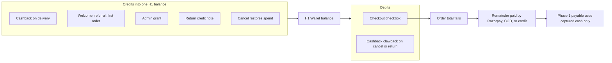

# Phase 2 recommendation — H1 Wallet dashboard

This recommendation follows `INVESTIGATION.md`. It does not change Phase 1 payable maths. The repository has no separate wallet product brief. The needs below are the Phase 2 checklist in the investigation request, checked against the code that actually moves money.

## 1. What should be built

Horeca1 already has three money systems. Phase 2 should make the **H1 Wallet** (table `wallets`) a proper ledger and give admin and the customer a complete view of it.

Phase 2 should not rebuild DiSCCO, and it should not create a second way to pay suppliers. Those already have screens:

- Credit lines: `/wallet`, `/admin/credit`, supplier credit tools.
- Supplier payouts: `/admin/finance` and `/vendor/receive`.

The H1 Wallet today is one spendable balance filled by rewards, admin grants, and return credit notes, and spent as a checkout reduction. That is the product. A cash top-up wallet, four separate balances, and supplier withdrawals are not required by the current checkout, refund, or payable code. Adding them without a client rule would create a new cash liability that Phase 1 cannot see.

## 2. What already exists and should be reused

| Piece | Reuse it as |
| --- | --- |
| `wallets` + `wallet_transactions` | The only customer spendable ledger. Do not add a second balance table |
| `CashbackEntry` | The source document for rewards and grants. Keep `walletTxnId` |
| `promotionService` spend, refund-on-cancel, cashback settle, clawback, grant | The write path. Phase 2 wraps these with idempotency and a running balance rather than a new calculator |
| `allocateWallet` | Partial spend. Online orders keep ₹1 for Razorpay. The customer still cannot type an amount unless the client asks for that |
| `creditPrepaidWalletForCreditNote` | How a return becomes H1 credit |
| `/rewards` and the checkout checkbox | The customer surface. Extend them |
| `/admin/promotions` grant | The current admin credit. Move the operational view to a wallet screen and keep the campaign editor where it is |
| Credit-line stack | Leave it. Repayment webhooks, freeze, expiry, and CSV statements stay on `CreditWallet` |
| Phase 1 `assessPayable` and finance batches | Leave the formula. H1 spend must remain invisible to “customer paid” |
| Claim table between finance and the old supplier wallet | Leave it. Do not add a third settlement owner |

## 3. What to improve, and what is missing

### Improve

- **History.** `/rewards` stops at 50 ledger rows and 100 cashback cards. There is no running balance, date filter, or link from a debit to the order screen beyond the raw id.
- **Idempotency.** H1 credits and debits are guarded by “look for an existing row” inside the transaction. There is no unique key. Admin grant has no key at all. Two grant clicks create two credits.
- **Audit of admin credits.** The grant writes an audit action and optional notes. A wallet screen should require a reason and show who credited the customer.
- **Names.** “H1 Wallet”, “Horeca1 Credit”, and `paymentMethod = wallet` describe different things. The dashboard copy should use H1 Wallet for the spendable balance and Horeca1 Credit for the pay-later line.
- **Cancel vs return.** Cancel puts `walletApplied` back. A Razorpay refund of the same order does not. Phase 2 should define one rule and implement it (see open questions).
- **Supplier wallet screen.** It is a provisional ledger. The dashboard payout button tells the supplier that money is on the way, then stores `INSTANT-<time>` and does not contact a bank. That screen should stop being a payout control. Phase 1 “What I receive” stays the payout screen.

### Missing on the H1 Wallet

- Customer cash top-up.
- Separate cash, refund, reward, and promo balances.
- Admin search across customers, debit, freeze, and CSV.
- Expiry of credited rupees.
- A reconciliation report of `balance` versus the sum of transactions.
- A database constraint that balance cannot go below zero.

### Do not build in Phase 2

| Idea | Why it stays out |
| --- | --- |
| Razorpay “add money” | No caller, no verification route, and no payable rule. Stored cash spent at checkout would lower `totalAmount` and would not appear as a captured payment, so the supplier payable would ignore it |
| A second supplier wallet or withdrawal flow | Phase 1 already pays from captured cash, fees, and commission. The old wallet is a mirror that settlement clears |
| Rebuilding DiSCCO inside the new dashboard | Limits, dues, interest, freeze, and Razorpay repayment already work on `/wallet` |
| Merging `/wallet` and `/rewards` into one balance | One is debt. The other is spendable credit. Adding them together would be wrong |
| Four spendable pockets with no spend order | Checkout can spend only one number today. Pockets need a client rule for which rupee is used first and which one a credit note may refill |

## 4. Screens

### Admin — H1 Wallet

New area, for example `/admin/finance/wallets` or `/admin/wallets`. It is not the credit page and not Pay suppliers.

- Search by customer name, phone, or user id.
- Balance, and a status if freeze is in scope.
- Ledger: date, credit or debit, amount, balance after, source label, reference (order number, credit-note number, campaign, admin grant), actor, reason.
- Grant and debit. Both require an amount and a reason. Debit cannot pass the balance. Each write stores an idempotency key so a double submit does not post twice.
- Download CSV for one customer and for a date range across customers.
- A reconciliation strip: ledger sum versus stored balance, count of rows missing a source, and grants with no cashback entry.
- Link to the customer’s credit lines, without editing them here.
- Do not show supplier payout actions on this screen.

### Customer — H1 Wallet

Keep `/rewards` as the page, or add a clear H1 Wallet section on it. Do not replace `/wallet`.

- Balance in rupees.
- Each row in plain language: “Cashback from order PO-…”, “Credit note CN-…”, “Used on order PO-…”, “Restored because the order was cancelled”, “Reward from Horeca1”.
- Pending cashback that is not in the balance yet (“credited after delivery”).
- UPI rewards stay labelled as UPI, not as wallet balance.
- Empty, pending, and spent states. No fake totals.
- Checkout checkbox stays as it is: use the balance, or not. A custom amount is a later change, only if the client asks.

### Supplier

No new supplier wallet product.

- `/vendor/receive` remains “what Horeca1 will pay me”.
- `/vendor/wallet` should be labelled as the older earnings record, in the same spirit as `/admin/ledger`, or removed from the primary nav once operations agree.
- The instant-payout button should be removed from the supplier’s path so it cannot claim orders away from finance or show a bank reference that was never sent. That is a safety change to the old wallet, not a change to the payable formula.

## 5. Backend and database

Stay on `wallets` / `wallet_transactions`. Suggested columns, added in a migration on `demo` only when implementation starts:

| Change | Purpose |
| --- | --- |
| `balance_after` on `wallet_transactions` | Statement and reconciliation |
| `source` enum matching today’s `referenceType` values | Stable labels. Keep writing `referenceType` until callers are moved |
| `idempotency_key` unique | One post per grant, credit note, checkout order, cancel refund, and cashback settlement |
| `actor_id` and `reason` nullable | Required for admin grant and debit |
| `frozen_at` on `wallets`, only if the client wants a freeze | Checkout spend refuses a frozen wallet. Credits can still be posted |

Backfill `balance_after` from existing rows ordered by `created_at, id`. If the running sum does not equal `wallets.balance`, report the user. Do not silently “fix” the balance in the backfill.

Service rules:

- All H1 writes go through one module used by promotions, returns, and the new admin routes. Callers stop touching `prisma.wallet` directly.
- Unique key conflicts return the existing row.
- Admin debit and checkout debit use a row lock and reject a result below zero.
- Grant, credit note, cashback settlement, checkout spend, and cancel refund each have their own key format (`grant:<id>`, `return_credit_note:<returnId>`, `cashback:<entryId>`, `order_redemption:<orderId>`, `order_redemption_refund:<orderId>`).
- CSV is generated from the ledger, not from the 50-row rewards query.
- No new Razorpay route in this phase.

APIs to add, all authenticated:

- `GET /api/v1/admin/h1-wallets` — search and balances.
- `GET /api/v1/admin/h1-wallets/:userId` — detail and statement.
- `POST /api/v1/admin/h1-wallets/:userId/adjust` — credit or debit, reason required, idempotency key required.
- `GET /api/v1/admin/h1-wallets/export` and `GET /api/v1/promotions/rewards` extended with paging — customer history.
- `GET /api/v1/admin/h1-wallets/reconciliation` — mismatches only.

Permission: a dedicated `h1Wallet.view` / `h1Wallet.adjust`, or reuse a finance permission that is not `wallet.view` (that key is the supplier wallet today).

## 6. Phase 1 supplier payables

Phase 2 must not change `assessPayable`, commission, Razorpay fee handling, batch draft/finalise/settle, or the claim unique index.

Connection to keep:

- H1 spend reduces what the customer still owes on the order. It is not cash collected.
- Supplier payable stays based on captured cash.
- Delivery may still credit `VendorWallet` for cash methods. Finance mark-settled may still clear that provisional credit. Phase 2 does not add another debit on settle.
- Credit notes increase the H1 balance and do not create a supplier recovery. Money refunds still create a recovery only through the existing payable refresh.
- Vendor-funded cashback is a platform cost today. Phase 2 should not silently deduct it from the supplier payable. If the client wants the supplier to fund it, that is a payable change and a separate decision.

Risks Phase 2 should not make worse:

- Do not treat an H1 credit as `payments.status = captured`.
- Do not let an admin H1 debit or grant change `VendorWallet` or a payable line.
- Do not call `requestInstantPayout` or `createSettlementBatch` from the new screens.
- Leave `discco` as an order-service alias. The supplier-wallet skip list omits `discco` while the payable treats it as non-cash. Fixing that skip belongs with the old settlement job, and only after confirming no live `discco` orders depend on the current credit. It is not an H1 feature.

Known supplier-wallet defects to record, and not to “solve” by paying the supplier again from Phase 2:

- A refund debit uses the full delivery net when a snapshot exists, not the refund amount, and it can reduce another order’s balance.
- A legacy batch can claim every order in the window while debiting only the cash still in the wallet.
- Instant payout marks a synthetic bank reference.

## 7. Risks

1. **Building a cash wallet by accident.** Top-up plus the current checkout would understate supplier payables, because the spent top-up is not a captured payment.
2. **Duplicate grants.** The current admin button can credit the same reward twice. Any new screen that calls the same function inherits that until the unique key exists.
3. **Short clawback.** If the customer has spent a cashback credit, cancel or return cannot take the full amount back, and the entry is still cancelled.
4. **H1 spend lost on a gateway refund.** The Razorpay refund returns only the card/UPI portion. `walletApplied` stays spent.
5. **Credit-line returns.** Cancelling a credit order releases the debt. Returning it often does not. A money refund of `paymentMethod = wallet` can also debit the supplier wallet even though that sale never credited it.
6. **Two supplier payout stories.** Finance payables and the old wallet can disagree. The weekly job still runs after finance drafts and can take orders finance is not ready to pay (COD not captured, fee unknown, missing commission).
7. **Negative H1 balance.** Checkout is serializable. Grants and credit notes are not, and Postgres does not check `balance >= 0`.

## 8. Decisions needed before development

1. Is the H1 Wallet only rewards, credit notes, and admin credits — or must customers also add cash with Razorpay?
2. If cash top-up is required, is that cash payable to the supplier when it is spent, and how should the `payments` row be written so Phase 1 counts it once?
3. Must refund, reward, and promotional rupees be separate balances? If yes, which balance is spent first, and which balance receives a credit note?
4. On a Razorpay refund, should `walletApplied` return to the H1 Wallet, stay spent, or return only when the whole order is cancelled?
5. Should a return of a DiSCCO or Horeca1 Credit order reduce outstanding, credit the H1 Wallet, or do both? Both would give the customer the goods value twice.
6. Do H1 credits expire? If yes, from the credit date or the campaign end, and what happens to a balance that is partly spent?
7. Can admin freeze an H1 Wallet? Can new credits still be posted while it is frozen?
8. Can admin debit the H1 Wallet, and is a reason plus a second person required?
9. Should the supplier instant-payout button be removed so only Pay suppliers moves settlement state?
10. Should vendor-funded cashback reduce that supplier’s payable? Today it does not.

Until 1, 3, 4, and 9 are answered, the safe build is a single tagged balance, no top-up, no new supplier payout, and no change to payable maths.

## 9. Suggested build order and tests

### Phase 2A — Ledger integrity

Unique idempotency key, `balance_after`, row lock, non-negative debit, backfill report. No new screen. Existing checkout, grant, cashback, and credit note keep their amounts.

### Phase 2B — Admin and customer history

Search, full statement, source labels, CSV. Grant and debit with reason, using the new key. `/rewards` reads the same statement API.

### Phase 2C — Refund rule and freeze

Implement only the cancel/refund and freeze behaviour the client confirmed. Add the supplier-wallet safety change (hide instant payout) if they confirm decision 9.

### Phase 2D — Only after an explicit yes

Cash top-up with a payable design, separate buckets, expiry, or supplier-funded cashback inside the payable. Each one needs its own payable test before it is written.

### Tests before any of this is called done

- Spend ₹500 on a ₹1,000 online order: one debit, `walletApplied` 500, Razorpay remainder 500, payable cash 500, no second debit on retry.
- Cancel that order: one refund credit, second cancel is a no-op, balance restored once.
- Deliver a ₹100 cashback: one credit. Deliver the same order again: no second credit.
- Admin grant retried with the same key: one credit. Two different keys: two credits.
- Credit note of ₹200: one H1 credit, supplier wallet unchanged, payable unchanged.
- Credit note retried: still one credit.
- Admin debit larger than the balance is rejected and writes nothing.
- Frozen wallet, if built: checkout spend fails, existing credit lines still work.
- A credit-method order still does not increase the Phase 1 payable.
- Reconciliation lists a tampered balance and does not auto-correct it.
- Concurrent double grant and concurrent double credit note against one return.

Run the existing payable and claims tests after every phase and confirm their results are unchanged. Verify the new admin and customer screens in the browser on `demo` only: grant, statement, CSV, checkout spend, and a cancel that restores the same amount.
